# Lane A's overhaul: a walkthrough

What lane A changed, in a reader's order, as it is on `main` (Nov 16), plus the card-paper fix in PR #46. The page shots are 1440 × 900, from the emulator's own browser, which opens the headset page. The book shots are from the IWSDK emulator's living room with its panels and input gizmos hidden. Each screen has one line on what it is, and one on what it replaced.

**Not here:**
- **The bookplate and the phone page (`/link/`).** Sign-in is off in this build, and lane D is finishing its fixes. Their screenshots come with that work.
- **The landing's hero.** It's unchanged since PR #11, and the redesign is next.

## The page

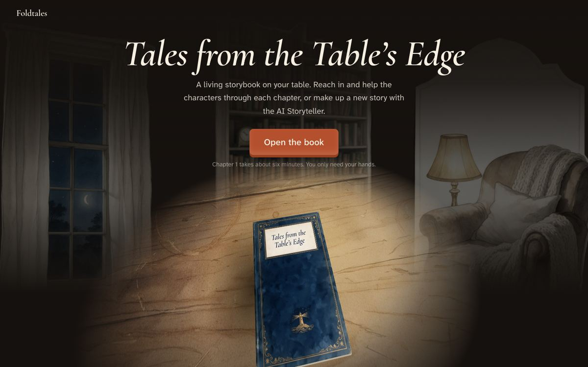
**First visit.** The one button opens chapter 1, with the time it takes and that you only need your hands.
*Before → after:* same hero (PR #11). The button's words now come from the library, the one source for every chapter.

**Back mid-chapter.** "Continue chapter 1", where you stopped, and "Start chapter 1 again".
*Before → after:* the words were hard-coded for chapter 1 in two places. Now they follow whichever chapter you're in.

**Back after finishing.** "Read chapter 1 again", with "More chapters on the way".
*Before → after:* unchanged in look. "Continue to chapter 2" appears here once lane B lists it.

## The AI Storyteller's door

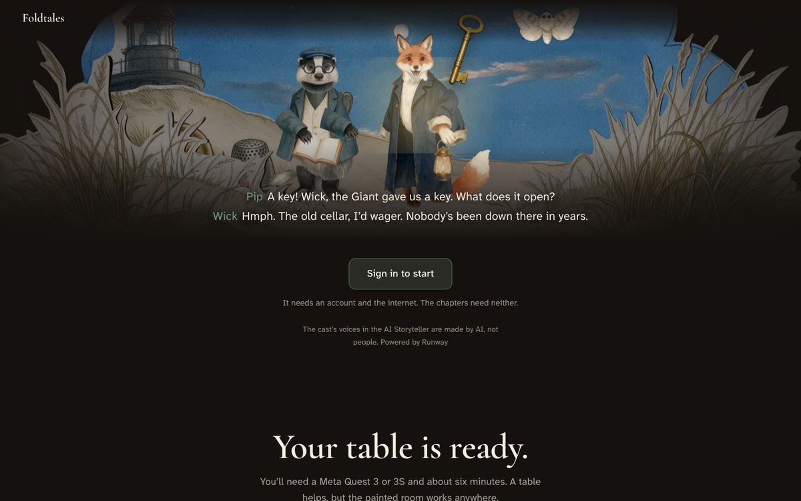
**Signed out.** "Sign in to start". It needs an account and the internet; the chapters need neither. Under it, quietly: the cast's voices are made by AI, and Powered by Runway.
*Before → after:* the door showed one button that asked for the microphone. Now it shows one state at a time from lane D's provider, each with its one step.

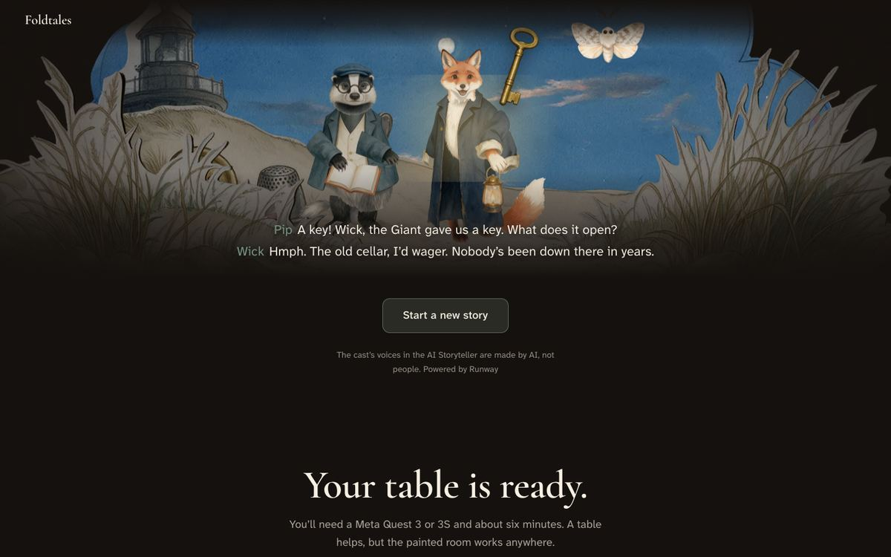
**Ready.** "Start a new story" (and "Your stories" once you've finished one).

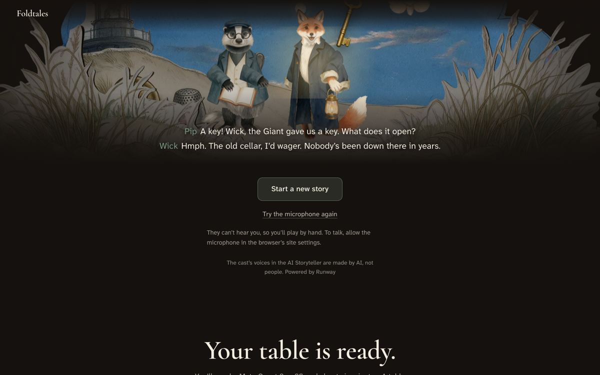
**Microphone refused.** You can still start a story and play it by hand, or try the microphone again.
*Before → after:* the door used to stop at "allow the microphone".

## Your book

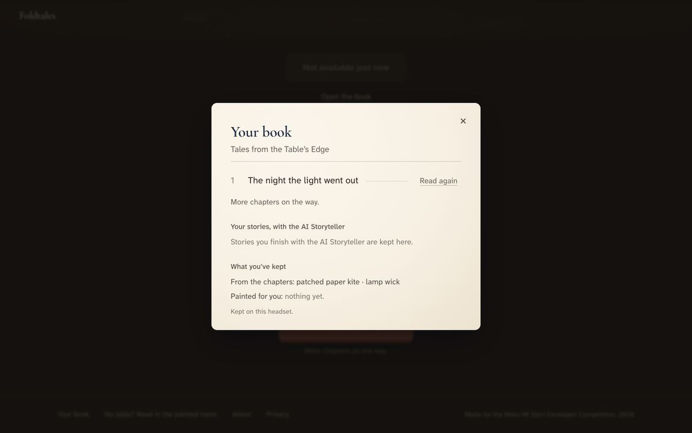
**Your book.** Each chapter with what a tap does, your finished stories, and what you've kept, by name ("patched paper kite · lamp wick"), kept on this headset.
*Before → after:* the "Chapters" sheet: a list of chapters with "started" or "read", nothing you could tap, and nothing about what you'd kept.

## When things go wrong, on the page

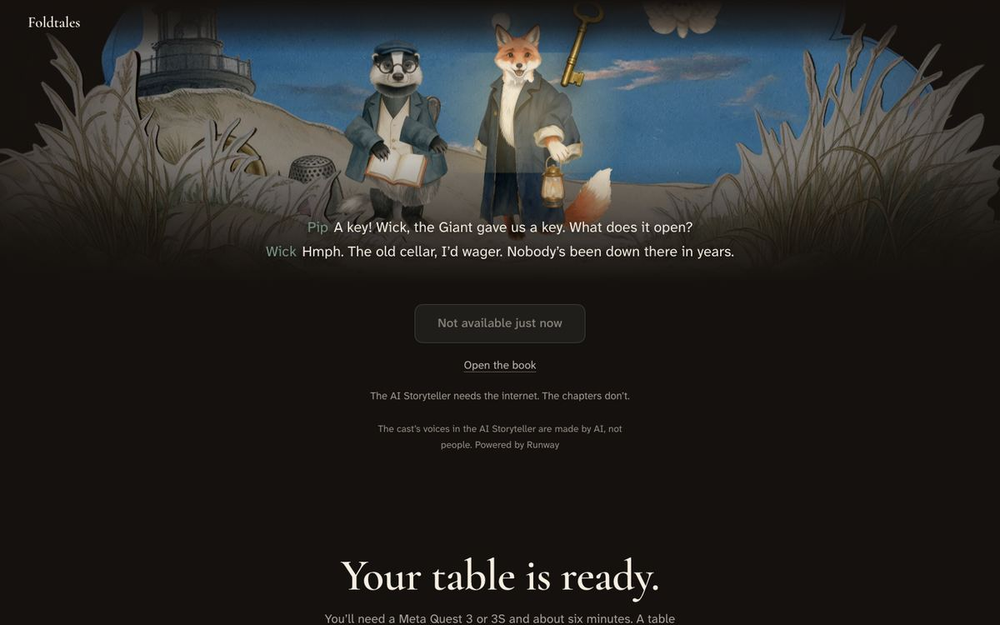
**Offline.** The door greys out with the reason, and "Open the book" sits beside it. The chapters are unaffected.
*Before → after:* the door let you into the Storyteller offline.

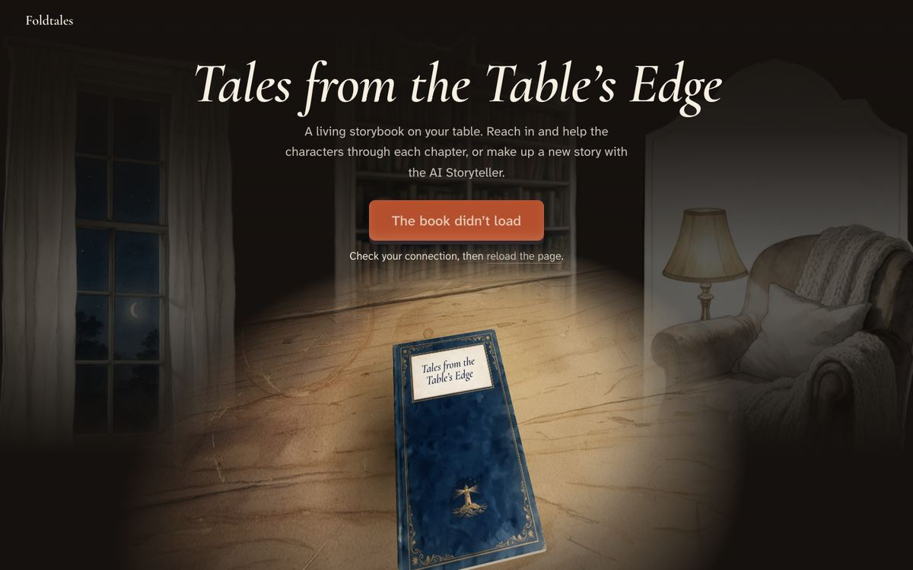
**The book didn't load.** Check your connection, then reload. (Unchanged.)

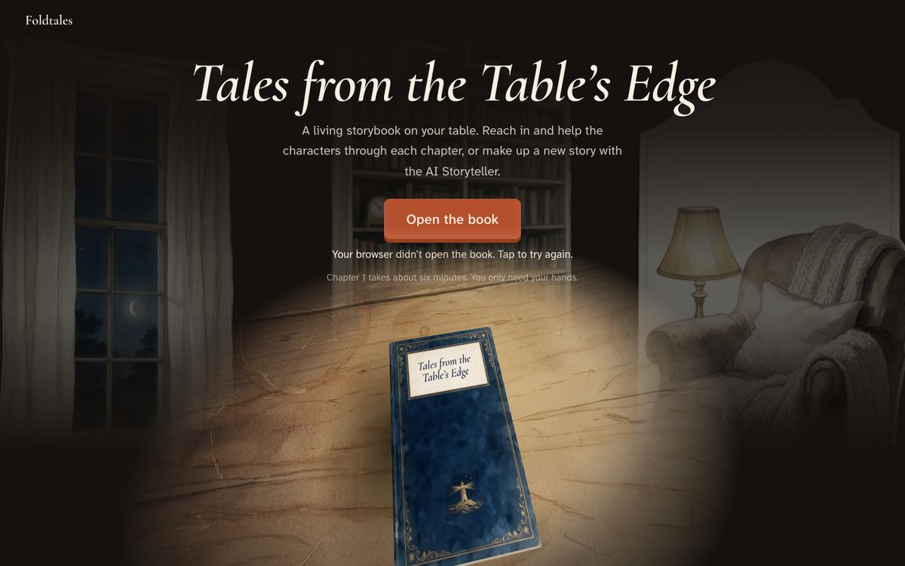
**The browser didn't open the book.** "Tap to try again", after 12 seconds. (Unchanged.)

## In the book

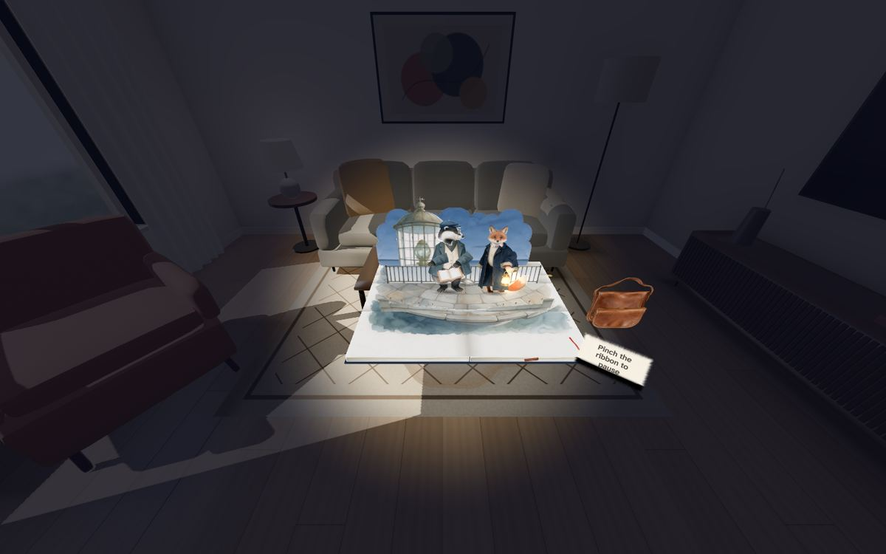
**The book opens.** A small standing card by the ribbon, "Pinch the ribbon to pause", until you've used the ribbon once.
*Before → after:* the wrist tag's "Pinch me: pause, start again, leave", which only showed if you turned your left wrist.

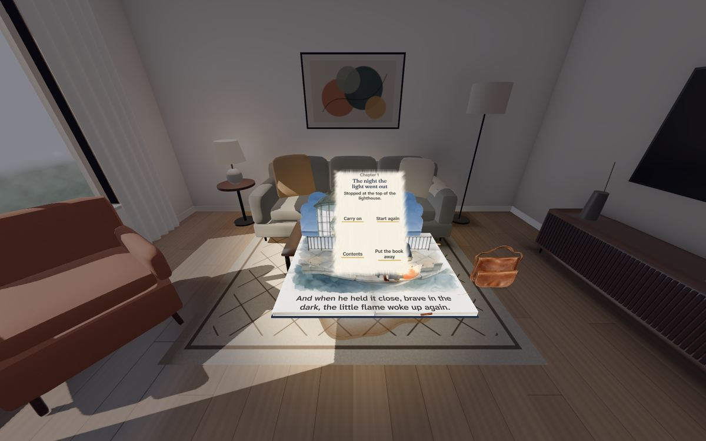
**The pause card.** Pinch the ribbon, and a paper card pops up from the spread, turned to face you. It shows Chapter 1, the title, where you stopped, then Carry on · Start again · Contents · Put the book away. The story waits. Its type is at least 1° tall, and each choice is a 64 mm target.
*Before → after:* the ribbon only paused, with nothing to choose, and the wrist tag fanned out three small tags you pinched with your other hand.

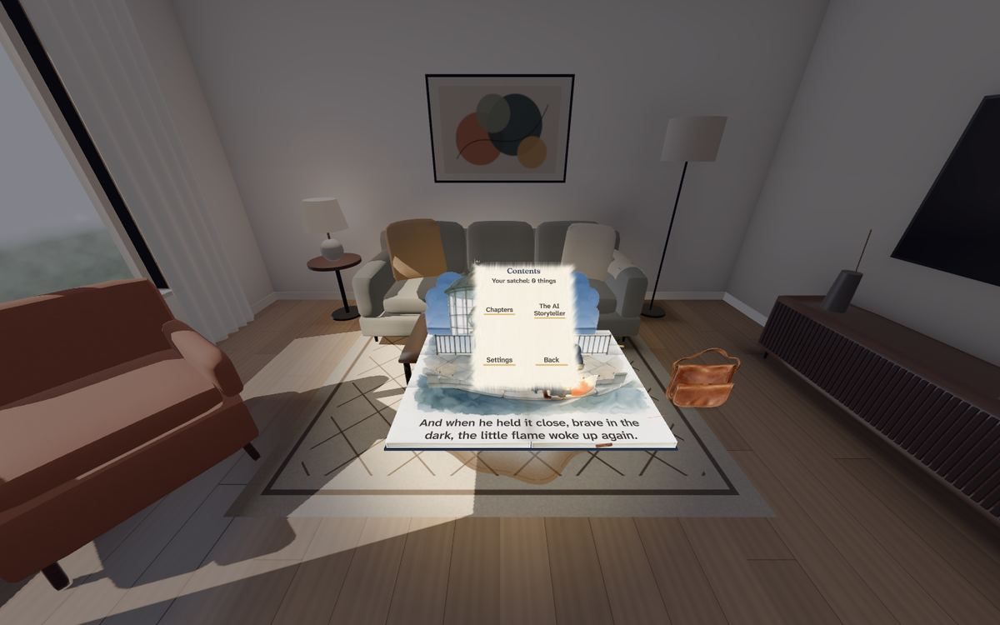
**Contents.** Chapters, the AI Storyteller, Settings, Back, and how many things are in your satchel.
*Before → after:* a sage tab painted on the book that did nothing. It's gone.

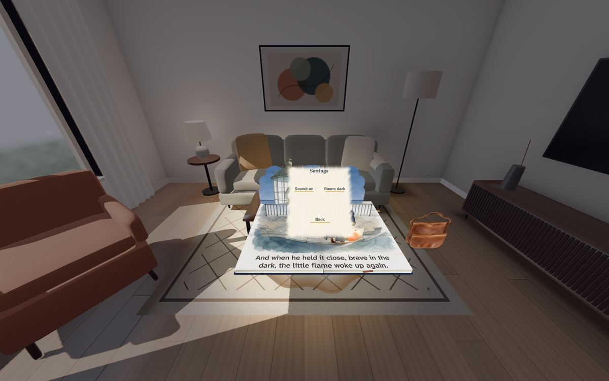
**Settings.** Sound on or off, and the room: dark or lighter.
*Before → after:* there were no settings.

**Holding something when a card opens** (no picture: it's a movement). What you held goes back where it came from, with no gift and no drop. A page held mid-turn falls back. *Before → after:* new.

**Put the book away, then Continue.** The book closes, your place is kept, and the page says "Continue chapter 1" (the second shot above). One tap and the book comes back to your place.
*Before → after:* "Put the book away" was on the wrist tag only.

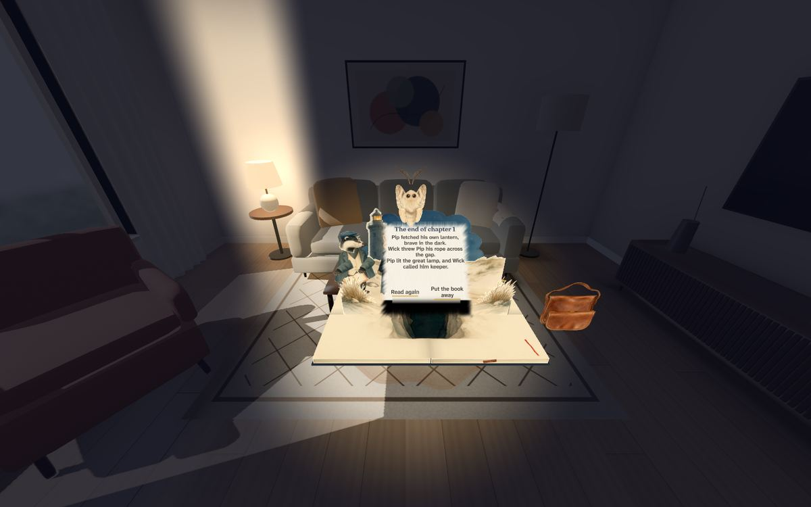
**The end of a chapter.** "The end of chapter 1", what lasts, what you kept, then Read again (or Continue to chapter 2) and Put the book away.
*Before → after:* one printed line, "The end of chapter one · Read it again", and no way out but the system menu. (Captured before #46, so it still shows the dark band under the card that #46 removes.)

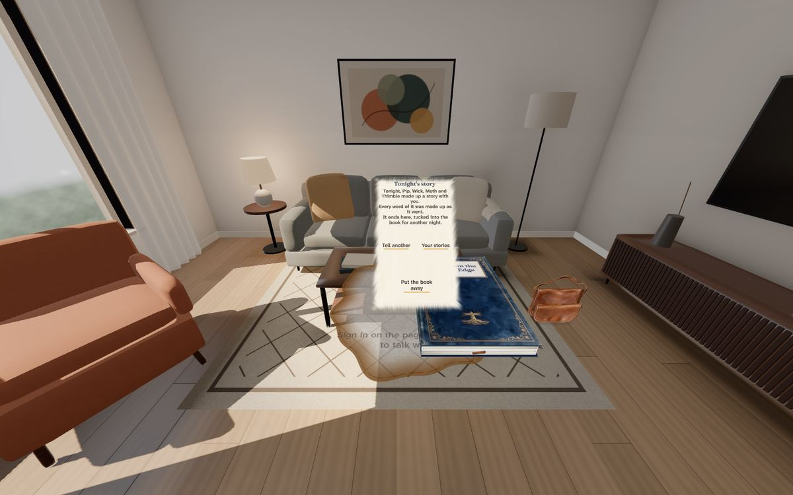
**The end of a story.** Its title and lines, then Tell another, Your stories and Put the book away. This one is lane D's ending when the AI can't be reached.
*Before → after:* a Storyteller story had no ending.

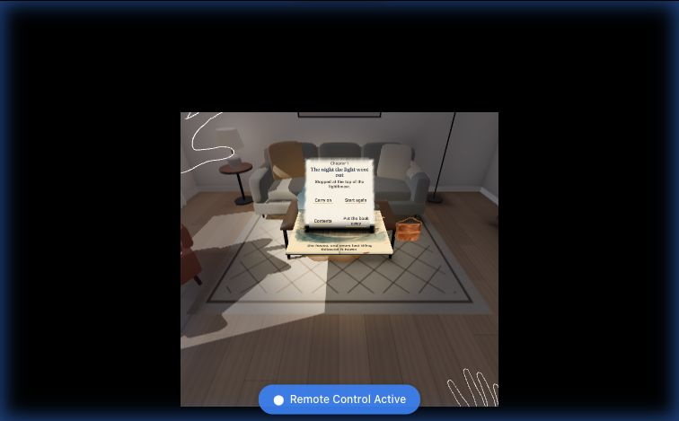
**On VR Glasses.** The card inside the glasses' narrower view, chosen by looking and pinching.
*Before → after:* new. (From the lane's emulator pass on Nov 16, so before #46's paper fix.)
